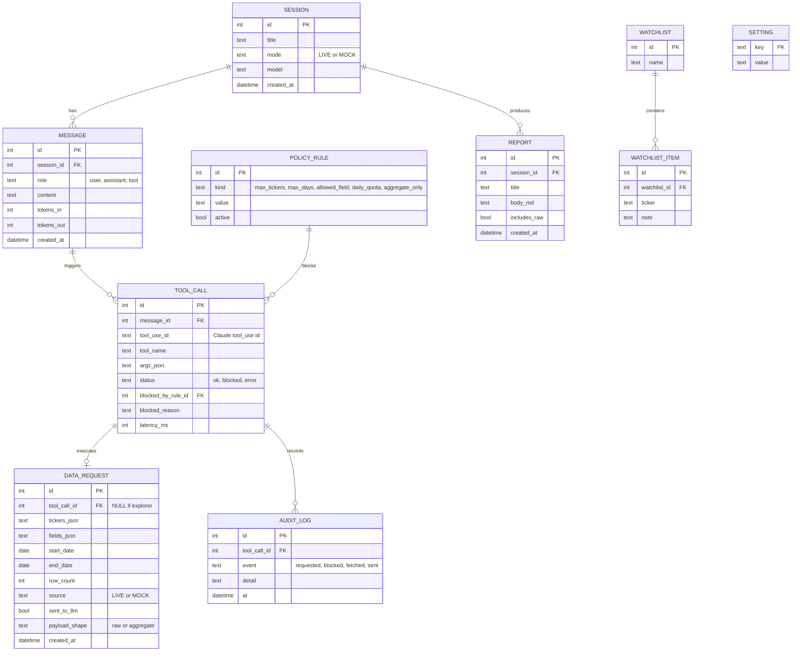

# ERD — BBG Bridge (가칭) v1.0

> 338 · 2026-10-14 · SQLite 단일 파일 `bbg_bridge.db`
> **원칙: 조회한 시세 값 자체는 저장하지 않는다.** 요청 메타·행 수·전송 여부만 남긴다. 캐시는 메모리·TTL ≤ 5분.

## 테이블 설명
| 테이블 | 용도 | 비고 |
|---|---|---|
| SESSION | 대화 1건 | 모드·모델을 대화 시작 시 고정 |
| MESSAGE | 대화 메시지 | role=tool은 요약만(원표 대신 "N행 전송" 문구) |
| TOOL_CALL | Claude가 요청한 도구 호출 | 차단이면 어떤 규칙이 막았는지 연결 |
| DATA_REQUEST | 실제 조회 메타 | 탐색기 수동 조회는 tool_call_id NULL·sent_to_llm=false |
| POLICY_RULE | 정책 가드 규칙 | 설정 화면에서 편집 |
| AUDIT_LOG | 사건 이력 | 교수 점검용, 삭제 UI 없음 |
| REPORT | Markdown 보고서 | includes_raw 기본 false |
| WATCHLIST(_ITEM) | 관심종목 | |
| SETTING | 키-값 설정 | API 키는 저장하지 않음(.env/키체인) |

## 기본 정책 값(초안, PI 조정)
| kind | value |
|---|---|
| max_tickers | 10 |
| max_days | 1825 (5년) |
| allowed_field | PX_LAST, PX_VOLUME, CUR_MKT_CAP, PE_RATIO, BEST_EPS 등 허용 목록 |
| daily_quota | 200 요청/일 |
| aggregate_only | true (Live 기본값) |
