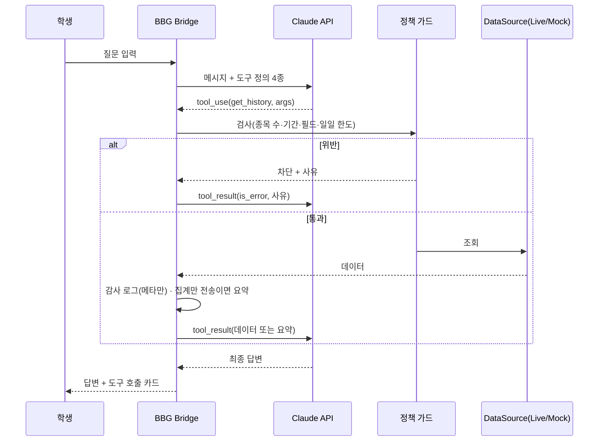

₩# IA — BBG Bridge (가칭) v1.0

> 338 · 2026-10-14 · PRD 기능 ID(F1~F8)와 연결

## 1. 화면 트리
```
BBG Bridge (http://127.0.0.1:8765)
├─ 상단바 (모든 화면): 모드 배지 LIVE/MOCK · 오늘 조회량/한도 · 설정 바로가기
├─ 1. 채팅 /chat  (홈)                        F1 F2 F3
│   ├─ 1-1 대화 목록(세션) — 새 대화 · 이름 바꾸기 · 삭제
│   ├─ 1-2 대화창 — 메시지 · 도구 호출 카드(펼치면 종목·필드·기간·행 수·차단 사유)
│   └─ 1-3 "보고서로 저장" → 4로 이동
├─ 2. 데이터 탐색기 /explore                   F8
│   └─ 종목·필드·기간 입력 → 표/차트 (Claude로 전송 안 함 표시)
├─ 3. 관심종목 /watchlist                      F6
│   └─ 목록 · 종목 추가/메모 · "이 목록으로 질문하기" → 1
├─ 4. 보고서 /reports                          F6
│   ├─ 4-1 목록
│   └─ 4-2 보기 · .md 내보내기 · 원자료 포함 여부 표시
├─ 5. 감사 로그 /audit                         F5
│   └─ 필터(날짜·도구·차단만) · 시간·도구·종목·필드·행 수·전송 여부·차단 사유
└─ 6. 설정 /settings                           F3 F4 F7
    ├─ 6-1 API 키 · 모델 · 최대 반복
    ├─ 6-2 모드(Live/Mock) + 터미널 연결 점검 버튼
    ├─ 6-3 정책(허용 필드·한도·집계만 전송)
    └─ 6-4 MCP 서버 켜기/끄기 · Claude Desktop 설정 예시 복사
```

## 2. 핵심 흐름 (채팅 질문 1건)


## 3. 내비게이션 원칙
- 왼쪽 세로 메뉴 6개, 휴대폰 폭에서는 아래 탭 막대
- MOCK 모드는 상단바 주황 배지 + 모든 표·차트 제목 앞에 "[가상]" 표기
- 차단은 오류가 아니라 정상 응답으로 보여 준다(사유와 고치는 법 함께)

## 4. 화면 ↔ 기능 ↔ 데이터 대조표
| 화면 | 기능 | 읽기/쓰기 엔터티 |
|---|---|---|
| 1 채팅 | F1 F2 F3 | SESSION · MESSAGE · TOOL_CALL · DATA_REQUEST · AUDIT_LOG |
| 2 탐색기 | F8 | DATA_REQUEST(sent_to_llm=false) · AUDIT_LOG |
| 3 관심종목 | F6 | WATCHLIST · WATCHLIST_ITEM |
| 4 보고서 | F6 | REPORT |
| 5 감사 로그 | F5 | AUDIT_LOG · TOOL_CALL · DATA_REQUEST |
| 6 설정 | F3 F4 F7 | SETTING · POLICY_RULE |
